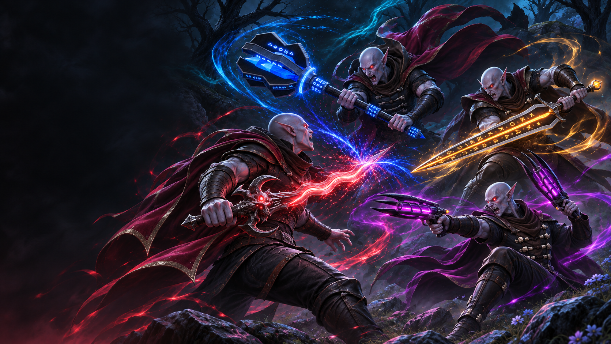
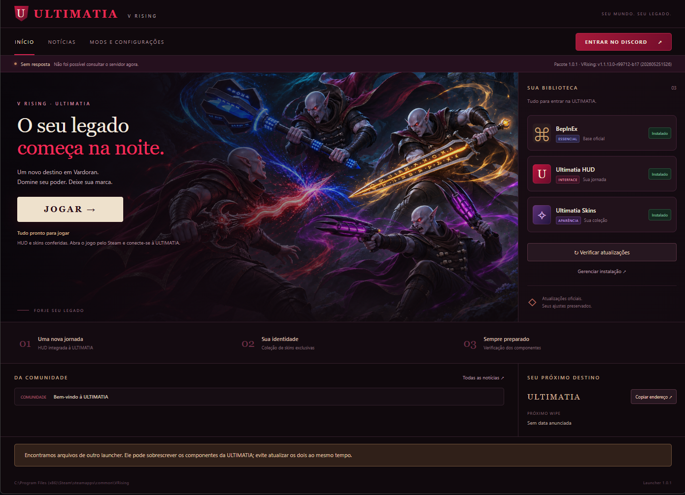

# ULTIMATIA
### O seu legado começa na noite.

**Launcher para V Rising · Windows x64**

[**⬇ BAIXAR O LAUNCHER**](https://github.com/UltimatiaDemory/Ultimatia-Launcher/releases/latest) · [Entrar no Discord](https://discord.gg/jqYDS2EWpH) · [Notas das versões](https://github.com/UltimatiaDemory/Ultimatia-Launcher/releases)

Prepare seu V Rising para a ULTIMATIA em um só lugar. Instale e atualize a HUD e a coleção de skins, confira os componentes e abra o jogo pela Steam.

## Comece em três passos

1. **Baixe e instale** o arquivo `Ultimatia-Launcher-Setup` da versão mais recente. O instalador cria o atalho na área de trabalho.
2. **Feche o V Rising**, abra o launcher e clique em **Instalar / Atualizar**. Ele procura o jogo na Steam; se necessário, selecione a pasta que contém `VRising.exe` em **Mods e configurações**.
3. **Clique em Jogar** e conecte-se ao servidor **`190.115.197.105:9910`**.

A primeira instalação precisa de internet. Na primeira abertura do jogo, o BepInEx pode levar mais tempo para preparar os arquivos de integração.

## Conheça o launcher

| Componente | Função |
| --- | --- |
| **BepInEx para V Rising** | Base necessária para carregar os mods, baixada diretamente do repositório dos mantenedores. |
| **Ultimatia HUD** | Interface integrada à sua jornada na ULTIMATIA. |
| **Ultimatia Skins** | Coleção de visuais exclusivos para suas armas. |

A atualização dos mods usa manifesto assinado e verifica os arquivos por SHA-256. A instalação preserva suas configurações e outros plugins. Feche o jogo antes de instalar ou reparar componentes.

## Atualização e suporte

- Use **Verificar atualizações** para conferir o pacote de mods e reparar arquivos necessários.
- Atualizações do próprio launcher são distribuídas nesta página: baixe o instalador da versão mais recente.
- Se o jogo fechar durante a abertura, envie o arquivo `BepInEx/LogOutput.log`, quando existir, no [Discord da ULTIMATIA](https://discord.gg/jqYDS2EWpH). Os registros do launcher também estão disponíveis em **Mods e configurações**.
- O instalador Windows não possui assinatura digital.

Este repositório distribui o launcher compilado e informações públicas. Os códigos-fonte dos mods ULTIMATIA não são publicados. O BepInEx é obtido separadamente do [projeto para V Rising](https://github.com/CrimsonMods/BepInEx/releases).
